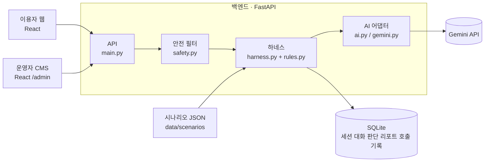
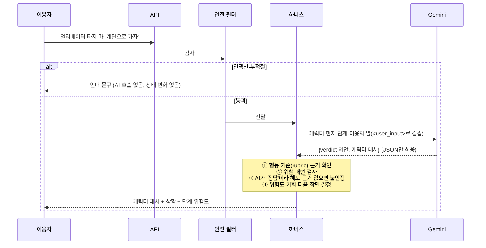
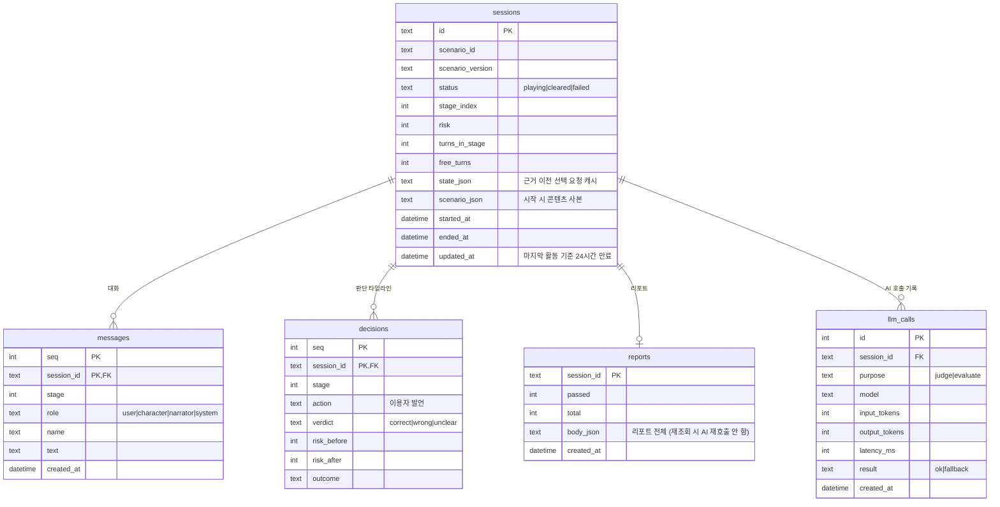

# 아키텍처 · 기능 목록 · DB 초안

작성: 장우석 / 갱신: 2026-11-26 / 기준: 최종 로컬 제출 구현
상태 표기: ✅ 구현됨 · 🟡 일부 · ⬜ 예정

---

## 1. 전체 구조

| 구성 요소 | 역할 | 상태 |
|---|---|---|
| 이용자 웹 (`frontend/`) | 목록 → 브리핑 → 채팅 플레이 → 판단 복기 | ✅ |
| API (`main.py`, `schemas.py`) | 요청·응답, 같은 세션 직렬화·요청 재전송 중복 방지 | ✅ |
| 안전 필터 (`safety.py`) | 인젝션·부적절 표현을 AI 호출 **전에** 차단 (토큰 비용 0) | ✅ |
| 하네스 (`harness.py`, `rules.py`) | 단계·위험도·기회·근거·장면·리포트를 **서버가 결정** | ✅ |
| AI 어댑터 (`ai.py`, `gemini.py`, `prompts.py`) | 캐릭터 대사·판정 제안·단계별 피드백. 키 없으면 가짜 AI, 피드백 오류 시 기본 문구 | ✅ |
| 시나리오 (`data/scenarios/*.json`) | 롤 문서 + 단계 문서 + 행동 기준(rubric) + 출처 | ✅ 화재·지진 2개 |
| DB (`db.py`, SQLite `backend/mia.db`) | 세션·대화·판단·리포트·AI 호출(토큰) 저장, 재시작 후 이어하기 | ✅ |
| 운영자 CMS (`cms.py`, `scenario_check.py`, `AdminHome/AdminEditor.jsx`) | 시나리오 만들기·편집·검사·공개, 미리 플레이, 간단한 이용 현황 | ✅ 콘텐츠는 JSON 파일, 플레이 통계는 DB |
| 로그인·결제 | 기관 단위 이용권 | ⬜ |

## 2. 한 턴의 흐름 (멘토가 가장 중요하게 보는 부분)

핵심: **AI는 말하고 제안한다. 진행은 서버가 정한다.** 등록한 조작 표현과 검증 사례에서 상태 보존을 확인했으며, 모든 새로운 인젝션을 막는다고 보장하지 않는다. (실제 AI 확인 범위: `docs/실제AI_리허설.md`)

---

## 3. 기능 목록

우선순위: **A** = 멘토 시연 필수(3주차) · **B** = 4주차 목표 · **C** = 상용화 단계(발표에서 계획으로 설명)

### 이용자

| 기능 | 상태 | 우선 |
|---|---|---|
| 시나리오 목록 보기 | ✅ | A |
| 임무 브리핑 (역할·목표·연습 역량) | ✅ | A |
| 캐릭터와 채팅하며 판단 | ✅ | A |
| 단계·위험도·남은 기회·이전 선택 표시 | ✅ | A |
| 판단 복기 리포트 (타임라인·발언 근거·출처) | ✅ | A |
| 다시 도전 | ✅ | A |
| 리포트 AI 피드백 문장 | ✅ 인용 검증·실패 시 기본 문구. 총평·점수는 서버 기록 기준 | B |
| 플레이 기록 저장·이어하기 | ✅ 새로고침·서버 재시작 후 목록에서 '이어하기' (24시간 만료) | B |
| 두 번째 시나리오 (지진) | ✅ 학교 지진 5단계 | B |
| 장면 이미지 | ✅ 원본 SVG 10개·실패 대체 표시 | B |
| 로그인 | ⬜ | C |
| 내 플레이 기록 목록 | ⬜ | C |
| 유사 시나리오 추천 배너 | ⬜ | C |
| 결제·결제 이력 | ⬜ | C |

### 운영자 (교사·기업 안전 담당자)

| 기능 | 상태 | 우선 |
|---|---|---|
| 시나리오 작성 | ✅ CMS 편집기 (JSON 직접 작성도 가능) | A |
| 시나리오 만들기·복제·수정·검사·공개 (CMS) | ✅ `AdminHome.jsx`, `AdminEditor.jsx`, `backend/app/cms.py` | A |
| 작성 중 시나리오 미리 플레이 | ✅ | A |
| 장면·캐릭터 이미지 업로드 | ⬜ | C |
| 소속 이용자 플레이 현황·통계 | 🟡 시나리오별 플레이 수·많이 놓친 단계·AI 토큰·1판 비용 (DB 기준). 기관별 구분은 로그인 후 | B |
| 운영자 로그인 | 🟡 공용 토큰 1개 (`ADMIN_TOKEN`). 기관별 계정은 로그인 기능과 함께 | C |
| AI 설정 (모델·말투 등) | ⬜ | C |

### 시스템

| 기능 | 상태 | 우선 |
|---|---|---|
| 인젝션·부적절 표현 차단 (서버 필터 + 프롬프트 2겹) | ✅ | A |
| AI 장애 시 기회·위험도 보존 | ✅ | A |
| 토큰 사용량 기록 | ✅ AI 호출마다 DB `llm_calls` (토큰·응답 시간·실패) | B |
| 세션 DB 저장·만료 | ✅ 매 턴 저장, 24시간 활동 없으면 만료 | B |
| 이용 한도(등급별) 서버 강제 | ⬜ 상용화 후속 범위 | C |
| 공개 배포 | ⬜ 제출은 단일 로컬 서버로 실행 | C |

최종 실행은 `start-local.cmd`로 /api와 빌드된 웹을 한 서버에서 제공한다. `offline` 인수로 명시적인 오프라인 체험을 선택할 수 있으며 화면에서도 모드를 구분한다. 동시 요청 보호는 단일 프로세스 기준이다. 발언의 request_id/expected_stage로 응답 손실 후 재전송과 이전 장면의 지연 요청을 처리한다.

---

## 4. 화면 목록

| 화면 | 사용자 | 상태 | 파일 |
|---|---|---|---|
| 시나리오 목록 | 이용자 | ✅ | `ScenarioList.jsx` |
| 임무 브리핑 | 이용자 | ✅ | `Briefing.jsx` |
| 채팅 플레이 | 이용자 | ✅ | `Play.jsx` |
| 판단 복기 리포트 | 이용자 | ✅ | `Report.jsx` |
| 로그인 | 공통 | ⬜ | |
| 내 플레이 기록 | 이용자 | ⬜ | |
| 시나리오 관리 (목록·이용 현황·새로 만들기) | 운영자 | ✅ | `AdminHome.jsx` |
| 시나리오 편집 (기본·배경·캐릭터·단계·평가·출처·JSON) | 운영자 | ✅ | `AdminEditor.jsx` |
| 이용 통계 상세 | 운영자 | ⬜ | |

곽동규 화면 목록(`docs/research/화면목록.md`)이 올라오면 이 표와 합친다.

---

## 5. DB 초안

### 4주차 최소 범위 — ✅ 구현됨 (`backend/app/db.py`, 테스트 `backend/db_test.py`)

아래 5개 테이블을 구현했다. 진행 중 세션은 메모리에 두고 매 턴 끝에 저장하며, 메모리에 없으면 DB에서 불러온다. 세션에는 시작 당시 시나리오 사본(`scenario_json`)과 상태(`state_json`)를 함께 저장해, 운영자가 나중에 시나리오를 고쳐도 기존 기록을 유지한다. 그림은 주요 컬럼이며 실제 정의는 db.py의 SCHEMA를 따른다.

- `llm_calls`에 토큰과 지연을 기록한다. 금액 추정에는 해당 모델의 검증된 단가 설정이 필요하며, 재시도 실패 호출의 사용량을 완전하게 집계하지 못할 수 있다.
- 시나리오는 JSON 파일로 관리하고, 세션에는 버전과 콘텐츠 전체 사본을 함께 저장한다.
- PostgreSQL 전환은 후속 계획이며 SQL·스키마·동시성 처리를 별도로 검증해야 한다.

### 상용화 단계에 붙일 테이블 (발표에서 계획으로 설명)

| 테이블 | 핵심 컬럼 | 이유 |
|---|---|---|
| `organizations` | id, name, type(학교/기업), plan | B2B 이용권 단위 |
| `users` | id, org_id, role(learner/operator/admin), email | 로그인·권한 |
| `scenarios` | id, version, org_id, status(draft/published), content(json) | CMS에서 시나리오 관리 |
| `assets` | id, scenario_id, kind(image), url | 장면·캐릭터 이미지 |
| `subscriptions` | org_id, plan, seats, monthly_limit, period | 등급별 이용 한도 |
| `payments` | id, org_id, amount, status, paid_at | 결제 이력 |

`sessions` 에 `user_id` 를 추가하면 "내 플레이 기록", 운영자 통계가 여기서 나온다.
